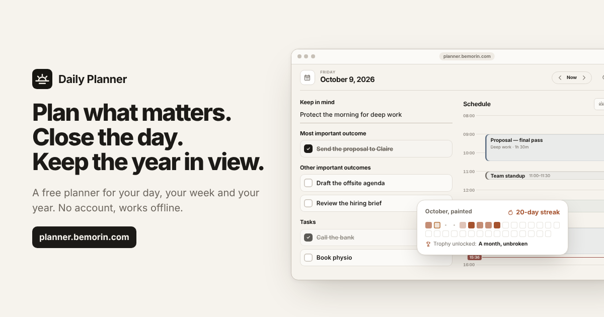

# Daily Planner

A calm, local-first planner for your day, your week and your year. Choose what matters, give it time on your schedule, close the day without losing unfinished work, and keep the year in view.

It runs in the browser, installs as an app on a computer, tablet or phone, works offline, and needs no account. It is free for everyone, and its code is open source under the [MIT licence](./LICENSE).



The hosted planner is at [planner.bemorin.com](https://planner.bemorin.com/), with a tour of it at [planner.bemorin.com/welcome/](https://planner.bemorin.com/welcome/).

## Contents

- [What it does](#what-it-does)
- [Principles](#principles)
- [Run it locally](#run-it-locally)
- [Tests and gates](#tests-and-gates)
- [Deploy your own copy](#deploy-your-own-copy)
- [Project structure](#project-structure)
- [Contributing](#contributing)
- [Support the project](#support-the-project)
- [Licence](#licence)
- [Name and logo](#name-and-logo)

## What it does

**One small loop, every day: Plan → Do → Close.**

- **Day** — one thing to keep in mind, the most important outcome, up to two others, tasks, notes and a time-blocked schedule with draggable, resizable blocks.
- **Week** — your planning days side by side, over the same schedule as the Day view.
- **Close day** — for each unfinished item, move it to a date, save it in Unresolved, or forget it; then keep a memory and a lesson from the day.
- **Unresolved, Journal and Stats** — one short list for work that slipped, a journal written one line a day, and where your time went by category.
- **Horizon** — the year on one page: a misogi (one year-defining challenge, with milestones), six mini-adventures, three commitments, a winning habit per quarter, a year map of key dates, and Progress, the year painting itself one closed day at a time.
- **The yearly ritual** — plan your year in a guided half hour and print it on one page, check in as each quarter ends, look back with your year in review, see what your days add up to in Insights, and paint the year in one of six palettes.
- **Also** — search, a floating window (Document Picture-in-Picture), print and Markdown export, full backups, share images of a week or a year, and Personal sync.

The in-app **How it works** page explains every feature and keyboard shortcut.

## Principles

- **Local-first.** Your plans are saved in your browser (`localStorage`, keys starting with `daily-planner:`), on your device. The planner opens and works offline once it has loaded.
- **No account.** Nothing to sign up for. A backup file moves everything from one browser to another.
- **Sealed sync.** Personal sync is optional and goes through the person's own Google Drive or Dropbox, never through our servers. The copy is sealed on the device before it leaves, with a passphrase only its owner knows (AES-256-GCM under a PBKDF2-SHA-256 key). See [`docs/PERSONAL_SYNC.md`](./docs/PERSONAL_SYNC.md).
- **Nothing sent by default.** With the checked-in configuration the planner makes no request to any server. A deployment can switch on a small owner API for feedback, questions and anonymous daily counts; the planner then shows a Privacy notice that lists exactly what is counted, and each device can switch the counts off.
- **No framework, no build step for the sources.** Plain HTML, CSS and JavaScript modules. The only third-party runtime code is a small vendored build of [Motion](https://motion.dev) for interface transitions.

## Run it locally

You need [Node.js](https://nodejs.org/) 22 (the version CI uses). There is nothing to install: the repository has no dependencies.

```bash
git clone https://github.com/bemorin/planner.git
cd planner
node scripts/serve.mjs
```

Then open <http://localhost:8080>. Edit any file and reload: the sources run as they are, with no build step. On localhost the service worker is unregistered, so a cached copy never hides your changes.

```bash
npm start              # the same server, and open the browser
npm run start:api      # also run the owner API and its dashboard at /admin/ (token "dev")
npm run start:api:fake # the same, printing emails instead of sending them
npm run serve:dist     # serve the production build in dist/
```

On Windows, **`Start Daily Planner.bat`** does the same with a double-click (`shortcut` adds a desktop shortcut, `dist` serves the build, `lan` makes it reachable from a phone on the same Wi-Fi). Without Node, `python3 -m http.server 8080` serves the planner too, without the API.

Browsers keep planner data per address (host and port), so the server always prefers port 8080.

## Tests and gates

Every change must pass these, locally and in CI ([`.github/workflows/verify.yml`](./.github/workflows/verify.yml)):

```bash
TZ=UTC node --test tests/*.test.js   # unit and integration tests
npm run lint                          # static guards and JavaScript parsing
npm run format:check                  # formatting
npm run check                         # repository checks: every module in sw.js, the CSP hashes of inline scripts, the licence
npm run quality                       # no-regression gate: app.js size and functions, !important count
npm run verify                        # all of the above, then the production build and a Chromium smoke test
```

The smoke test drives the real production build in Chromium; set `CHROME_BIN` when Chrome or Chromium isn't in a standard place. The release checklist is in [`docs/RELEASE_CHECKLIST.md`](./docs/RELEASE_CHECKLIST.md).

## Deploy your own copy

The planner is a static site, so any static host can serve it. The optional owner API (feedback, questions, the waitlist, anonymous counts and the dashboard at `/admin/`) runs on **Cloudflare Pages Functions with a D1 database**; this is how the hosted planner runs.

1. **Fork** this repository, and give your copy its own name and icons (see [Name and logo](#name-and-logo)).
2. **Create a Pages project** in Cloudflare (Workers & Pages → Create → Pages → connect to Git) on your fork, with the build command `node scripts/build.mjs` and the output directory `dist`.
3. **Create a D1 database** and bind it to the project with the variable name `DB` (Settings → Bindings). Create its tables from [`migrations/schema.sql`](./migrations/schema.sql), the whole schema of a fresh install: paste it into the D1 console, or run

   ```bash
   npx wrangler d1 execute <your-database> --remote --file=migrations/schema.sql
   ```

   It only creates what is missing, so running it again changes nothing.
4. **Set the variables** (Settings → Variables and Secrets), then redeploy. Build variables are written into the public `runtime-config.js` and are never secrets; Functions variables are read by the API.

   | Variable | Where | Needed for |
   | --- | --- | --- |
   | `DAILY_PLANNER_API_URL` | build | The owner API: set it to `/api`. Blank: the planner never calls a server. |
   | `ADMIN_TOKEN` | Functions (secret) | Signing in to the dashboard. Make one with `npm run admin:secret`. |
   | `ADMIN_TOTP_SECRET` | Functions (secret) | Recommended: an authenticator code at sign-in, on top of the token. |
   | `PUBLIC_BASE_URL` | Functions | Your copy's address, such as `https://planner.example.com`. |
   | `ALLOWED_ORIGINS` | Functions | Optional: other sites allowed to call the API. |
   | `RESEND_API_KEY`, `EMAIL_FROM`, `OWNER_EMAIL`, `EMAIL_DAILY_LIMIT` | Functions | Optional email through [Resend](https://resend.com): question notifications, the waitlist announcement, test emails. |
   | `DAILY_PLANNER_GOOGLE_CLIENT_ID`, `DAILY_PLANNER_DROPBOX_APP_KEY` | build | Optional Personal sync through Google Drive or Dropbox ([setup](./docs/PERSONAL_SYNC.md#deployment-setup)). |
   | `DAILY_PLANNER_GITHUB_URL`, `DAILY_PLANNER_SPONSOR_URL` | build | Optional links to your source code and your GitHub Sponsors page, such as `https://github.com/sponsors/bemorin`. Blank: hidden. |
   | `DAILY_PLANNER_X_URL`, `DAILY_PLANNER_LINKEDIN_URL` | build | Optional links in the footers. |
   | `DAILY_PLANNER_SUPPORT_EMAIL`, `DAILY_PLANNER_PRIVACY_EMAIL`, `DAILY_PLANNER_LEGAL_PHONE`, `DAILY_PLANNER_LEGAL_ADDRESS`, `DAILY_PLANNER_LEGAL_REGISTRATION` | build | The publisher's details on the legal pages. Blank details are left out. |

   Every variable, what it looks like and how to check it is in [`docs/configuration.md`](./docs/configuration.md); once deployed, the dashboard's **Configuration** page (`/admin/configuration/`) checks each one for real. The owner API itself is described in [`docs/FEEDBACK_AND_WAITLIST.md`](./docs/FEEDBACK_AND_WAITLIST.md).
5. **Make the legal pages yours.** `legal/` describes the hosted planner and names its publisher (`legal/legal-details.js`). A public copy needs its own legal notice, privacy policy and terms.

Without any variable at all, the build is a complete, local-first planner that sends nothing anywhere.

## Project structure

```text
index.html, app.js      the planner: its page and the coordinator of shared state
src/
  config.js             the runtime configuration, read from runtime-config.js
  domain/               pure planning rules (calendar, schedule time, note lines)
  features/             one module per feature: Week, Horizon, the yearly ritual, Insights, sync views, …
  state/                persistence: local store, settings, backups
  sync/                 Personal sync: the engine, the seal, Google Drive and Dropbox
  ui/                   reusable primitives: dialogs, listbox, popovers, motion, theme
  vendor/motion.js      vendored Motion (see THIRD_PARTY_NOTICES.md)
styles.css, styles/     the planner's styles, one file per domain, combined only for production
sw.js                   the service worker: the offline copy
welcome/                the public tour (/welcome/) and the modules the public pages share
contact/                the Contact page (/contact/)
legal/                  the legal notice, privacy policy, terms and cookies pages
admin/                  the owner dashboard (/admin/)
server/                 the owner API, as a fetch-style router with a pluggable store
functions/              the Cloudflare Pages Function that serves the API from D1
migrations/schema.sql   the D1 schema of a fresh install
scripts/                the local server, the build, the gates and the smoke test
tests/                  node:test suites
docs/                   configuration, the owner API, Personal sync, the release checklist
```

[`ARCHITECTURE.md`](./ARCHITECTURE.md) maps the runtime, the data model and its invariants, and the refactoring policy.

## Contributing

Issues and pull requests are welcome. Please read [`CONTRIBUTING.md`](./CONTRIBUTING.md) first: it explains the gates, the code style and why the planner uses no framework. To report a security problem, follow [`SECURITY.md`](./SECURITY.md) instead of opening a public issue.

Release notes are in [`CHANGELOG.md`](./CHANGELOG.md).

## Support the project

Daily Planner is free, with no ads and nothing to buy. If it helps you and you'd like to support its work, you can sponsor it on GitHub Sponsors at [github.com/sponsors/bemorin](https://github.com/sponsors/bemorin). Sponsoring is never required, and nothing in the planner depends on it.

## Licence

The code is released under the [MIT licence](./LICENSE), copyright (c) 2026 Ben Morin. The licence does not cover the project's name and logo: [`TRADEMARKS.md`](./TRADEMARKS.md) says what it leaves out and lists the files that carry the logo.

The third-party component it ships, Motion, keeps its own licence: see [`THIRD_PARTY_NOTICES.md`](./THIRD_PARTY_NOTICES.md).

## Name and logo

The MIT licence covers the code, not the identity of the project. The name “Daily Planner by Ben Morin” and the Daily Planner logo (`favicon.svg`, the app icons and `welcome/og.png`) are not licensed for reuse. If you publish a fork or run a public copy, please give it a name and a logo of your own, and don't present it as the original; saying that it is based on Daily Planner is welcome.
